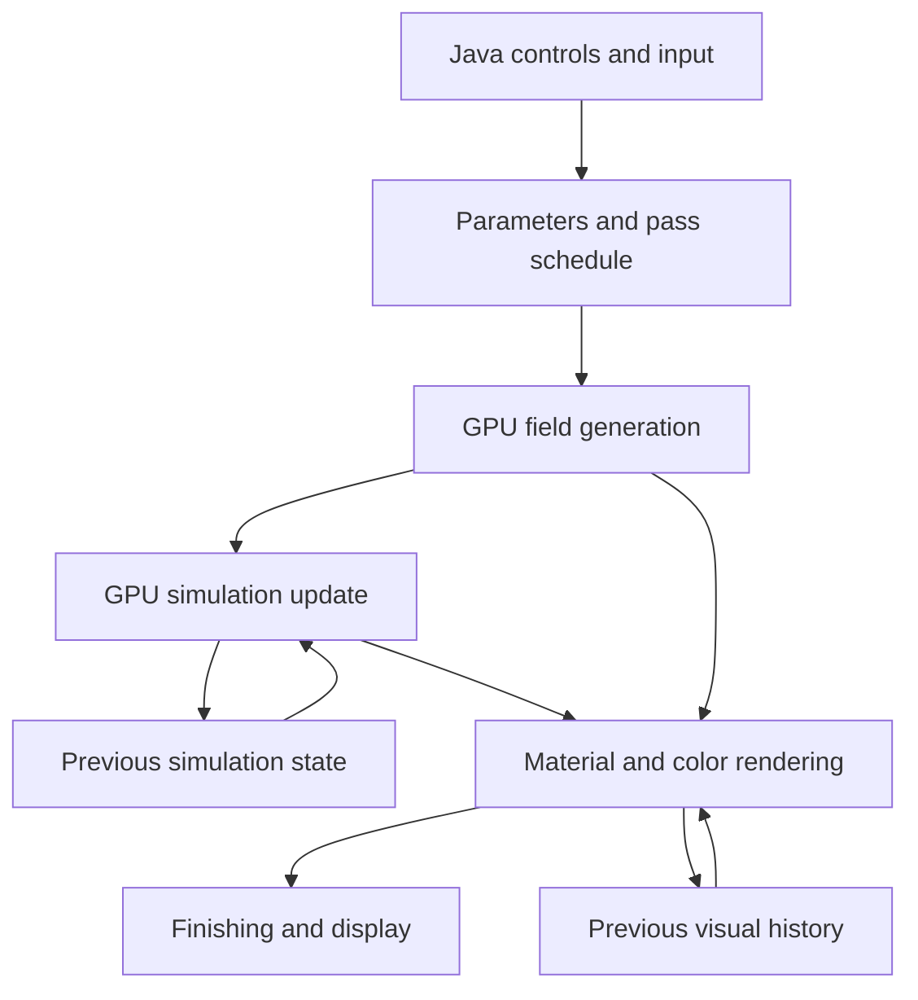

# Windows Procedural Visual Engine Project Specification

Version 1.2 · November 4 2026 · Planning and implementation reference

Build a Windows desktop program that combines procedural generators into evolving visual materials, patterns, and simulations. Java 25 controls the application and its artistic direction. LWJGL exposes the graphics APIs. GLSL shaders perform most spatial computation, simulation, and rendering on the GPU.

The visual goal is a system that produces surprising, coherent scenes with changing color, multiple scales of motion, apparent depth, and memory. It should support deliberate composition as well as exploration, with seeds and presets preserving discoveries.

This specification preserves the ideas discussed so far and develops them into an implementation plan. The platform and CPU/GPU division are agreed requirements. Architecture details, numeric defaults, feature ordering, and UI choices below are proposed implementation defaults. They can be changed without changing the core vision. Code fragments are interface examples or pseudocode unless explicitly described otherwise; this is a design reference rather than a completed application.

# 1 Decisions and scope

## Agreed requirements

| Area | Requirement |
| --- | --- |
| Platform | Windows desktop |
| Application language | Java 25 |
| Graphics integration | LWJGL |
| Computation | Most procedural generation and visual processing on the GPU |
| CPU role | Change control values, handle application behavior, and send parameters and commands to the GPU |
| Visual content | Multiple procedural generators combined in unusual ways |
| Color | An integral evolving part of the effect |
| Time | Changes structure, motion, color, and generator relationships |
| Creative goal | Visually rich, distinctive, experimental results |

## Proposed technical baseline

Use Windows x64, LWJGL 3, GLFW for windows and input, OpenGL 4.3 core as the minimum graphics API, and GLSL 430 shaders. OpenGL compute dispatch is core from 4.3 onward [S3]. Prefer a currently maintained stable LWJGL release compatible with Java 25, then pin that exact release and all native dependencies. LWJGL documents a JDK 25 FFM backend starting with 3.4.0 [S1].

OpenGL 4.3 is the baseline, not a claim that every Windows computer supports the application. Check the actual context and capabilities at startup. Windows version support and minimum practical GPU performance remain release decisions to establish through testing.

Do not require OpenGL 4.4 buffer storage, 4.5 direct state access, bindless textures, vendor-specific extensions, or Vulkan for the initial version. Optional paths can be added behind capability checks after measurement.

Use a Gradle Wrapper and a Java 25 toolchain as the proposed build setup. Select and pin a Gradle release whose compatibility documentation supports running with or building for the chosen JDK. Keep that verification in the implementation setup task rather than inventing a version here.

## First playable scope

The first useful version should open a window and render an animated procedural material with two nested warp layers, a curated evolving palette, optional temporal feedback, interactive controls, deterministic reset, and preset saving. Add a dedicated flow field and transported pigment next. Reaction–diffusion, advanced history, particles, and a visual graph editor follow after the core pipeline is dependable.

Desktop wallpaper integration, audio input, networking, online sharing, 3D volume rendering, and video encoding are later possibilities. They are not dependencies of the first version.

# 2 Visual direction and artistic behavior

## Make fields behave like materials

Noise should influence more than pixel brightness. Interpret it as height, velocity, chemical concentration, age, roughness, boundary distance, emission, or a local clock. Give different interpretations different controls. A single field can contribute to surface height and pigment distribution without forcing identical contrast curves for both.

Build recognizable relationships: color follows a current; ridges catch light; older pigment fades; cells exchange material at their boundaries. These relationships let complex scenes remain readable.

## Compose several scales

Use a hierarchy of broad form, medium structure, and fine detail. Large shapes establish composition. Medium structures carry movement. Fine details supply texture and occasional sparkle. Avoid making every scale equally strong or equally fast.

Suggested starting ratios are artistic defaults: broad evolution over tens of seconds, visible flow over several seconds, and small accents over shorter intervals. Expose these as independent rates, with a master time scale that preserves their relationship.

## Control contrast and color density

Provide calm areas, dark or low-contrast regions, and a few focal highlights. A fully saturated image with strong detail everywhere can lose its structure. Let bright accents emerge from behavior such as high curvature, new growth, pigment collision, or particle convergence.

Use curated palettes and smooth transitions. Preserve palette anchors while changing their relative contribution. Randomize within useful ranges and offer parameter locks so users can keep a good composition while exploring its color or motion.

## Make interaction physical

The pointer can inject pigment, create a vortex, attract particles, deform a local domain, or slow a local clock. Give each interaction a radius, strength, and decay. Choose one default interaction per preset and show its meaning in the controls.

Normalize pointer input to the visual viewport, not the whole window including panels. Account for framebuffer scaling. Sample drag paths continuously enough that a fast pointer does not leave disconnected injection dots.

# 3 Application architecture

## CPU responsibilities

Java owns window lifecycle, event processing, input mapping, preset loading, graph configuration, parameter animation, UI, filesystem operations, shader source management, and scheduling GPU work. Keep its per-frame work proportional to controls and passes rather than image pixels.

Java can calculate a few slow artistic signals such as a palette transition envelope or scene phase. It should not calculate a full image-sized modulation map and upload it every frame. Spatially varying signals belong in GPU programs unless an external input genuinely supplies that data.

## GPU responsibilities

Shaders evaluate analytic generators, build reusable fields, evolve persistent simulation state, move particles, sample history, interpret surfaces, assign color, and produce the final image. State remains in GPU textures and buffers across frames.

The CPU issues a sequence of rendering and dispatch commands. A compute shader does not automatically imply simultaneous execution with rendering; GPU scheduling and overlap must be measured. The initial design gains efficiency by retaining data and exposing parallel pixel or particle work.

## Execution and ownership

Start with one main thread that owns GLFW event processing, the OpenGL context, and all OpenGL calls. A context must be current on its calling thread and can be current on only one thread at a time [S2]. Create LWJGL capabilities after making the context current.

Worker threads may read files, decode resources, serialize presets, and encode completed image readbacks. They enqueue requests for GPU resource creation or shader compilation on the context thread. Avoid multiple shared contexts in the first implementation. Explicitly close GPU objects before destroying the context; garbage collection is not a resource lifecycle plan.

## Data flow



History in this diagram represents explicit previous-step resources. It does not authorize reading and writing the same image during one operation. The actual resource schedule uses distinct read and write allocations.

# 4 Field types and generator contracts

## Treat a generator as a typed source

| Field type | Example contents | Typical consumers |
| --- | --- | --- |
| Scalar | Noise value, height, concentration | Masks, thresholds, color lookup |
| Vector 2 | Velocity, coordinate displacement | Advection, particles, domain warping |
| Vector 3 | Potential, normal, spatial displacement | Lighting or later 3D effects |
| Distance | Distance to a shape or feature | Boundaries, seams, portals |
| Integer ID | Cell or region identity | Stable region variation |
| Color | Linear RGB or RGBA | Compositing, display feedback |
| Persistent state | Chemicals, pigments, age | Subsequent simulation steps |
| History | Previous fields or images | Delays, echoes, temporal excavation |

Every field definition records its component meanings, numeric range, coordinate space, time basis, boundary behavior, and units where applicable. A velocity measured in domain units per second must not be interpreted as texture pixels per frame.

Do not silently treat an integer cell ID as a smooth scalar. Hash it into a stable scalar or use an explicit palette mapping when that is the intended operation. Use nearest sampling for IDs and suitable interpolation for continuous fields.

## Analytic and stored representations

An analytic generator is evaluated directly inside a shader. A stored generator writes into a texture or buffer for other passes. Choose based on cost and reuse, not a rule that every graph node needs a texture.

Fuse small analytic operations that share coordinates. Cache expensive fields when several consumers use them. Make persistent simulations explicit passes. Record when the field was produced so a simulation step cannot accidentally use a display-time field from the wrong moment.

## Coordinate convention

Use a centered artistic domain with the vertical extent fixed and horizontal extent scaled by aspect ratio. For example, map the viewport to `x in [-aspect, aspect]` and `y in [-1, 1]`. Domain scale then controls visible frequency without stretching circles when the window changes shape.

Distinguish display coordinates, simulation texture coordinates, artistic domain coordinates, local warped coordinates, and history coordinates. Supply conversion helpers rather than duplicating ad hoc math across shaders. Resolution-independent coordinates make screenshots and presets more predictable.

# 5 Generator library

## Smooth noise and fractal combinations

Implement a small trusted noise library rather than several unrelated copies. Start with one smooth gradient or simplex noise implementation, cellular noise, and reusable fractal wrappers. Established GLSL implementations can be evaluated as dependencies, with their licenses and attribution retained [S9].

For fractal Brownian motion, sum octaves with increasing frequency and decreasing amplitude:

```text
fBm(p) = sum over i of amplitude(i) * noise(frequency(i) * p + offset(i))
frequency(i) = baseFrequency * lacunarity^i
amplitude(i) = gain^i
```

Normalize by the sum of amplitudes when a predictable range matters. Use fixed octave limits or shader variants so quality is bounded. Rotate or offset domains between octaves to reduce obvious repeated alignment. Expose frequency, gain, lacunarity, octave count, and seed-derived offsets.

Add transformations for ridged noise, turbulence using absolute values, terraces, smooth thresholds, and contrast remapping. Define output ranges after each transformation. Do not assume every noise implementation returns exactly the same interval.

## Cellular and Voronoi fields

Expose nearest feature distance F1, second-nearest distance F2, a boundary indicator, stable feature ID, and optionally the nearest feature position. `F2 - F1` is useful for seam-like effects but is not generally an exact geometric distance to the Voronoi boundary.

Feature motion should come from stable per-cell trajectories so identities remain coherent. A stateless moving cellular field can change topology without simulating cells as persistent objects. True merging, splitting, and exchanging conserved contents require explicit state or an approximation, and should be described accordingly in the UI and preset behavior.

## Waves and interference

Combine directional waves, radial waves, chirps, and warped phases. Each wave has a direction or center, wavelength, amplitude, phase, and angular speed. Interference fields can drive density, growth, displacement, or color rather than only being displayed directly.

Use slowly drifting frequencies or phases for moving beat patterns. Filter narrow bands at the output resolution to prevent flicker. Artistically inspired interference and iridescence do not need to claim physical optical accuracy.

## Distance fields

Provide circles, boxes, rounded shapes, capsules, rings, and combinations through union, intersection, subtraction, and smooth blends. Use distance fields as portal masks, boundary forces, and local deformation regions.

After strong nonlinear coordinate warping or an arbitrary mixed metric, a value derived from a signed distance function is generally no longer an exact Euclidean signed distance. It can still be a useful mask. Normalize edge width using local derivatives or another suitable estimate rather than assuming a universal distance scale.

## Flow fields

Start with analytic vortices, attractors, directional currents, and a 2D stream function. For smooth scalar potential `psi`, construct the velocity as a perpendicular gradient:

```text
velocity = (d(psi)/dy, -d(psi)/dx)
```

This produces a divergence-free field in the continuous smooth case. Discretization and later modifications change that property. For example, multiplying velocity by an arbitrary spatial mask or normalizing it can introduce divergence. Curl-noise is a procedural flow technique, not a complete fluid solver [S8].

Use analytic derivatives where available. Otherwise choose finite-difference spacing in the field's coordinate units and validate it across resolutions. Keep flow speed explicit and bounded.

## Stateful generators

Add pigment advection, reaction–diffusion, particle integration, age accumulation, and image feedback as separate persistent systems. Each system declares initialization, update, pause, reset, resize, checkpoint, and quality behavior. A simulation should not inherit those behaviors accidentally from the display renderer.

# 6 Composition operations

## Change coordinates

Domain warping uses one vector field to move the sampling position of another:

```text
q = p + warpStrength * warpField(p, time)
result = detailGenerator(q, time)
```

Build a two-component warp field from decorrelated scalar fields, not two identical evaluations. Nested warps can bend the first warp before it bends the final generator. Bound depth and strength so cost and behavior remain understandable.

Additional coordinate operations include rotation, scale, shear, periodic tiling, polar mapping, kaleidoscopic folds, and mapping along a contour. Handle the center of polar or logarithmic mappings with a minimum radius. For angular periodicity, use a circular embedding or explicitly periodic functions to avoid a visible branch seam.

## Change rules

Use a generator to modulate another generator's frequency, threshold, distance metric, growth coefficients, diffusion, or local speed. Clamp physically or numerically sensitive values to validated ranges. A field varying a reaction rate can produce different growth regimes across one surface; it can also destabilize a solver if its permitted range is unconstrained.

## Change interpretation

Use one scalar as height in one region, emission in another, and pigment density elsewhere. Mix interpretations with smooth masks. Keep geometry and color remapping separate so adjusting a palette does not unintentionally modify the simulation.

## Change state and history

Transport, accumulate, delay, erode, or react fields across updates. These operations create memory. Distinguish a coordinate warp, which changes where a field is sampled, from advection, which updates a stored field over time. They may look similar for one frame but behave differently under interaction and replay.

## Exchange generator roles

Treat role changes as explicit interpolation between compatible signals. To turn a cellular field from a color driver into a displacement source, remap it into the displacement range first. Separate smooth parameter transitions from structural changes that require compiling a new shader or allocating new state.

# 7 Visual concept catalog

These are creative recipes, not promises of physically accurate materials. Each should become a preset with bounded controls and a clear default interaction. Similar concepts share building blocks but differ in how those blocks are connected.

## Liquid opal

Combine broad fBm, nested domain warps, ridged detail, and interference bands. Interpret the result as a height surface. Derive normals from height gradients and apply broad highlights with a restrained iridescent color response. Rotate palette emphasis slowly while the large folds evolve at a different rate.

The pointer stirs the warp or adds a local bulge. Preserve quiet dark regions and a few luminous ridges. The initial implementation can be entirely analytic; optional pigment and feedback add memory later.

## Living contour maps

Generate a smooth height field, then extract repeated elevation bands. Animate the underlying field instead of independently moving the lines. Let a second slowly changing field choose flood levels, causing regions to become filled pools while nearby areas retain contours.

Map elevation and local change to color. Use antialiased bands whose width is meaningful in screen pixels. At high line density, fade fine bands rather than allow temporal shimmer. Pointer interaction raises or lowers the local terrain.

## Cosmic silk

Use broad curl-like flow, finer eddies, and GPU particles with persistent trails. Give particles stable variation in brightness, lifetime, and response to the current. Use depth-inspired size and opacity variation sparingly even in a 2D scene.

Color can follow speed, age, or a pigment field sampled by each particle. A persistent trail buffer supplies fabric-like threads. Pointer vortices bend the threads. This does not require a full incompressible fluid solver.

## Alien ecosystems

Combine cellular masks, reaction–diffusion, and slow environmental noise. Cells or regions modulate growth conditions; chemical boundaries become membranes or veins. Drive regional color seasons through stable IDs and a global seasonal envelope.

Inject or erase a chemical locally with the pointer. Growth, division-like pattern changes, and dissolution can emerge visually from the field, but should not be represented as a biological model. True persistent organism identity is a later layer if desired.

## Imperfect kaleidoscopes

Fold a domain radially, introduce local distortion after or before the fold, and place layered generators inside it. The location of the distortion determines whether symmetry remains exact or appears to fracture.

Blend between two complete symmetry mappings or rendered fields when changing fold count; merely rounding a changing count can cause jumps. Give central geometry, outer geometry, and palette independent phases. Use bounded detail near the center to prevent excessive aliasing.

## Temporal paintings

Read a previous visual texture through a slightly displaced coordinate map, decay it, and inject new generated marks. The result retains memories as folds, ghost structures, and ribbons.

Use timestep-aware decay and injection so the effect is not tied to monitor refresh. Separate feedback intensity from brightness and include a reset control. Control saturation and energy growth so repeated feedback does not converge to a white screen.

## Internal weather inside cells

Combine a cellular region map, local rotating currents, transported pigment, and reaction patterns near boundaries. Stable region identity determines local wind direction and climate phase.

Begin with a shared pigment field modulated by region masks. For actual isolated cells, explicitly prevent transport across boundaries; for controlled exchange, define permeability. Cell topology changes need a policy for redistributing contents rather than silently losing or duplicating pigment.

## Patterns inside patterns

Use a broad scalar field to define local tangent and normal directions. Sample stripes, cellular detail, or fine turbulence in a locally oriented frame so the details wrap around broad structures.

Where gradients are weak, blend toward a stable fallback orientation. A tangent frame alone is not a globally consistent contour coordinate system; begin with local orientation and add integrated streamline coordinates only when needed. Large forms evolve slowly while small interiors move faster.

## Time excavation

Store a ring of earlier fields or images. A depth field chooses how far back to sample at each point: `sampleTime = currentTime - depth`. Interpolate between valid neighboring history samples and color the result by age or change.

Store capture timestamps and use a defined capture interval. Sampling is limited by recorded history; it cannot reconstruct arbitrary earlier moments. After reset, mark unfilled layers invalid and use the earliest valid layer or a deliberate fallback.

## Changing geometry and distance

Blend circular, diamond-like, stretched, and warped distance measures in a cellular generator. Let a slow field control the blend locally so crystalline cells become soft, elongated regions.

Color by local metric blend or deformation. Maintain a stable search strategy that still considers sufficient nearby feature points under the allowed metrics. Bound anisotropy so distant omitted candidates do not produce sudden incorrect cell changes.

## Interference driven growth

Combine directional or radial waves and use constructive regions to alter growth rates or inject chemical seeds. Reaction–diffusion supplies persistent organic structure while phase drift moves the favorable regions.

Use different colors for new activity, established concentration, and fading remnants. Keep modulation slow enough that growth can respond, and validate solver stability under the entire animated coefficient range.

## Fluid palettes

Maintain several pigment concentration channels, advect them through related or different currents, and apply controlled diffusion or reaction terms. Convert concentrations to a palette mixture during rendering.

This makes color a transported part of the world. Normalize mixtures or use an explicitly chosen compositing model so overlapping channels do not accidentally add unlimited brightness. A stylized pigment mixture is not automatically a spectral paint simulation.

## Portals with different procedural rules

Use distance-field shapes as masks into worlds with different generators, coordinates, palettes, or motion. Build a transition band that interpolates compatible fields near the boundary.

For stateful worlds, maintain separate states and define what crosses the boundary. An initial version can composite independent simulations with a boundary distortion. Actual exchange requires explicit transport or injection rules. Avoid sampling a world in the wrong coordinate space at its seam.

## Generator role exchange

Start with noise driving displacement, waves driving color, and cells driving masks. Gradually interpolate toward a second assignment after normalizing the signals for their new roles.

Drive the exchange with a scene phase lasting long enough to recognize both states. Structural graph changes should prepare resources ahead of the transition; smooth role exchange should not trigger shader compilation every frame.

## Local clocks

Let different regions have different motion rates or phases. For an analytic pattern, use a time field to choose the local sampling time. Color by rate, accumulated age, or phase so the time structure becomes visible.

For variable speed over time, accumulate a local clock using `clockNext = clockPrevious + dt * speed`; `globalTime * changingSpeed` gives an extra time-dependent acceleration term and can jump. Reverse sampling time is possible for analytic fields or stored history. Negative timesteps do not generally reverse a dissipative simulation.

## Combined flagship direction

The preferred initial artistic direction is liquid opal with evolving palettes and optional flowing trails. A later flagship preset can combine transported pigments, local clocks, and time excavation: currents move across a surface while different regions reveal different ages of their own history.

Build and evaluate each ingredient separately before connecting all of them. Preserve an option to disable any layer so its contribution remains understandable.

# 8 Graph and pass scheduling

## Two connected representations

Use an artistic graph for generators and operations, and an execution graph for GPU passes and resources. They are related but not identical. Several artistic operations can compile into one shader; one simulation node can require several dispatches.

The initial implementation can describe these graphs in Java objects and preset data. A visual node editor is a later UI feature. Avoid making the first useful image depend on a complete graph authoring application.

## Node definition

Each node has a stable ID, type and version, typed inputs and outputs, parameters, seed policy, coordinate and time settings, implementation reference, and optional state descriptor. Parameter metadata includes display name, units, default, allowed range, interpolation method, and whether changing it requires state reset or recompilation.

Each execution pass declares resource reads and writes, access mechanism, target resolution, shader, workgroup size or draw geometry, update cadence, and dependencies. The scheduler uses these declarations to establish ordering and required synchronization.

## Feedback legality

Reject same-step cycles in ordinary dependencies. Permit feedback only through an explicit previous-step state or delay node. Topologically order the remaining dependencies. A cycle marked as a simulation still needs a numerical update rule; the label alone does not make arbitrary circular evaluation meaningful.

Do not alias an output resource with an input that is still needed. Resource reuse can be added when lifetimes are known, but persistent state and history remain live across frames. Allocate new graphs transactionally so a failed graph edit leaves the previous graph usable.

## Scheduling cadences

Support static fields regenerated only on relevant changes, fields updated per simulation tick, and visual-only fields evaluated per rendered frame. Cache a field only when its inputs and time basis match the consumer's requested state. Quality changes and resize events invalidate the appropriate caches.

# 9 Time system

## Separate clocks

Maintain a monotonic wall clock, application playback clock, fixed simulation clock, and bounded phases for artistic oscillators. Java can store long-running time in double precision. Do not use wall-clock calendar time as the simulation integrator.

Suggested starting simulation tick: 1/120 second. This is an application scheduling default, not a guaranteed stable integration step for every equation. A reaction solver may need multiple internal substeps or its own calibrated unit scale per tick.

## Interactive loop

```text
poll events and gather input
measure elapsed monotonic time
apply pending preset or graph changes at a safe boundary
if playback is active:
    add a clamped elapsed interval times playback speed to the accumulator
    while accumulator contains a full fixed tick and the step budget allows:
        evaluate controls at simulation time
        apply input events assigned to this tick
        upload simulation parameters
        execute the ordered simulation passes
        advance simulation time and subtract the tick
render the current state with presentation controls
draw the user interface and swap buffers
```

Use an interactive catch-up budget, for example eight ticks per frame as an initial setting. If the budget is exhausted, report slowdown and apply a documented backlog policy. After a long minimize or debugger pause, interactive mode may discard excess wall-clock backlog and resume without a burst of hundreds of steps. Offline export should process every required step instead.

Define zero speed as pause. Reverse playback initially applies only to analytic animation or recorded snapshots, not general simulations. A single-step control advances exactly one simulation tick.

## Modulation and smoothing

Offer sine and triangle oscillators, smooth random signals, envelopes, keyframes, and relationships between parameters. Use reproducible seeds for random modulation. Permit add, multiply, and remap connections with bounded output ranges.

For smoothing with response rate `lambda`, use `alpha = 1 - exp(-lambda * dt)` and update `value += alpha * (target - value)`. This makes the response less dependent on frame rate than a fixed interpolation fraction per frame.

Evaluate simulation-affecting modulation on simulation ticks. Evaluate display-only modulation at display time. A smoothed pointer force should not accidentally change its effective strength on a faster monitor.

## Phase precision and seamless loops

Avoid passing an ever-growing float time into all shader calculations. For periodic effects, send bounded phases computed from double precision time. For nonperiodic evolution, use a suitable high/low time representation, double arithmetic where justified, or a continuity-preserving coordinate strategy. Blindly wrapping nonperiodic noise time creates a visible jump.

Analytic loops can sample a higher-dimensional field using circular time coordinates, such as `noise(vec4(p, radius*cos(phase), radius*sin(phase)))`. This loops the analytic field when phase completes a revolution. A persistent simulation does not become seamless merely because its forcing loops; its state must also return to a compatible endpoint.

## Input replay

Record meaningful interaction events with simulation tick, location, radius, strength, mode, and duration or trajectory. Preserve event order. Replaying a seed without replaying user input cannot reproduce the same stateful scene.

# 10 Simulation systems

## Ping pong state

Allocate separate previous and next resources. Initialize both deliberately. During an update, all invocations read the previous state and write their assigned next element. After the pass and required dependency handling, swap logical roles.

Neighbor-based updates must not overwrite values that other invocations still need from the old step. An ordinary workgroup barrier cannot synchronize all workgroups in a dispatch. Use separate dispatches for phases requiring global completion [S3].

## Pigment advection

A simple first method backtraces each output point through a velocity field and samples the previous pigment field:

```text
previousPosition = position - dt * velocity(position)
nextPigment(position) = previousPigment(previousPosition)
```

Use a midpoint backtrace for better trajectory accuracy if needed. Bilinear sampling makes this a useful visual starting point, but semi-Lagrangian advection is numerically diffusive and is not inherently mass conserving. Choose whether fading and spreading are intended artistic behavior. Add higher-order transport or conservation measures only when the visual requirement warrants them.

Apply injection, decay, and optional diffusion with explicit units and a documented order. An exponential decay factor `exp(-decayRate * dt)` gives a time-based lifetime. Specify repeat, clamp, or reflective behavior for edges; wrapping is often a good initial option for abstract fields.

## Reaction diffusion

Use two concentration channels, A and B, and a validated discretization of a Gray–Scott-style system:

```text
dA/dt = DA * laplacian(A) - A*B*B + feed*(1-A)
dB/dt = DB * laplacian(B) + A*B*B - (kill+feed)*B
```

Start from A near one and localized B seeds. Select diffusion, feed, kill, grid spacing, and timestep together. Use a consistent Laplacian stencil and define whether coefficients are in physical-domain units or artistic grid units. Familiar example constants from another implementation are not portable without its timestep and stencil conventions. A research software implementation is a useful cross-check [S10].

Advance from old concentrations to new concentrations with the chosen integrator. If coefficients vary spatially, the discrete rule must reflect the intended model; multiplying a constant-diffusion Laplacian by a varying coefficient is not equivalent to all variable-diffusion formulations.

For an explicit solver, stability depends on diffusion, spacing, reaction terms, and timestep. Check representative extreme settings. Clamping concentrations can be a deliberate artistic safeguard, but it should not hide a fundamentally unstable update. Provide debug views and detection of nonfinite values during development.

## Particles

Store position, velocity if needed, age, lifetime, and stable variation in shader storage buffers. An initial particle follows the flow using Euler or midpoint integration. Derive respawn variation from particle ID, reset seed, and respawn counter rather than CPU-generated random values every frame.

Begin with direct drawing of a fixed particle count. Add culling, indirect draws, or GPU compaction only after a demonstrated need. Trails can be rendered into a separate fading texture or stored as particle history. Additive blending produces light-like accumulation; premultiplied alpha is useful for translucent compositing, with the chosen convention kept consistent.

## Local clock and age textures

Store accumulated local time or age in a persistent scalar field when its history matters. Update it with positive bounded rates unless the specific system has a meaningful alternative. Reset and resize policies must be explicit.

Half precision may be insufficient for a long-running clock. Use a 32-bit field, bounded phase plus cycle metadata, or another representation appropriate to its range. Color-by-age can use a normalized or logarithmic mapping without discarding the underlying state.

## Simulation reset and resize

Reset initializes every state buffer, history validity, event cursor, tick counter, and random counter. The same reset state must not depend on uninitialized GPU memory.

Separate viewport resize from simulation resize. A viewport resize should usually leave simulation state intact. When changing the simulation grid, choose either reset or deliberate resampling and disclose that choice. A resampled reaction system may change dynamics because grid spacing changed. Recreate resources outside the active pass, validate them, then swap to the new set.

# 11 Rendering pipeline

## Initial analytic renderer

Use a fullscreen triangle, a vertex shader that derives positions from vertex ID, an otherwise empty bound vertex array object for the core profile, and a fragment shader. This is sufficient for domain-warped noise, interference, contours, cellular materials, and many distance-field effects.

Render to an offscreen linear floating-point color texture when feedback, bloom, or image export requires it. The UI should be drawn after the artistic image so it is not accidentally fed back into the effect or included in clean exports.

## Extended pipeline

| Stage | Inputs | Output | Cadence |
| --- | --- | --- | --- |
| Field generation | Seed, parameters, simulation time | Flow, masks, reusable scalar fields | On change or simulation tick |
| Simulation | Previous state and current forcing | Next state | Fixed tick and internal substeps |
| Surface evaluation | Fields, pigments, coordinates | Height, normal or material signals | Usually display frame |
| Color and lighting | Surface signals and palette | Linear HDR image | Display frame |
| Optional visual feedback | Previous visual history and new marks | Next visual feedback state | Fixed visual tick for reproducibility |
| Finishing | Composited scene | Bloom, tone mapped image | Display frame |
| Presentation | Finished image and UI | Window framebuffer | Display frame |

Some stages can be fused. Store intermediate normals only if reuse or debugging justifies their bandwidth. Preserve a clear order when pigment simulation feeds color, and colored feedback then feeds later visual rendering.

## Surface interpretation

Treat a scalar as height and estimate its gradient to construct a normal, for example by normalizing `(-heightScale*dx, -heightScale*dy, 1)`. Use broad diffuse response and controlled highlights to reveal folds. Keep light motion slower than fine texture motion unless a preset deliberately calls for flashes.

Fragment derivatives can help with display-space antialiasing and certain surface calculations. They are not available as a substitute for explicit spatial differences in compute shaders. For stored fields, define sample offsets from texture resolution and domain conversion.

## Feedback and history placement

Choose whether history stores physical-like fields, pre-tonemapped visual color, or final display color. Each has a different purpose. Simulation fields preserve editability; pre-tonemapped feedback preserves luminous energy; final display images create graphic echoes but bake in previous color treatment.

Default visual feedback to a linear pre-tonemapped color texture. Avoid recirculating bloom without an explicit energy-control design. Store history after the intended stage, before the UI. Record that stage in presets and checkpoints.

## Finishing

Add a soft bloom pyramid for bright regions, exposure, and a chosen tone mapping curve. Keep the bloom contribution restrained and separable from source emission. Optional grain and vignetting should have controlled strengths and should not conceal weak underlying structure.

Output antialiasing for procedural bands and thresholds matters more than applying generic blur everywhere. When fine patterns become smaller than a pixel, reduce contrast or remove their contribution. Multisampling alone does not solve aliasing generated entirely inside a fragment shader.

# 12 GPU resources and memory

## Suggested formats

| Resource | Starting format | Notes |
| --- | --- | --- |
| Continuous scalar field | R16F or R32F | Use R32F when precision or range requires it |
| Flow or chemical pair | RG16F or RG32F | Signed flow requires a signed-capable representation |
| Pigment channels | RGBA16F | Three pigments plus an explicitly defined fourth channel |
| HDR scene and visual feedback | RGBA16F | Linear color with values allowed above one |
| Cell IDs | R32UI | Integer sampling and nearest filtering |
| Long-running local age | R32F or a bounded representation | Validate precision over session length |
| Particle state | SSBO with explicit layout | Prefer a simple aligned record initially |
| Temporal slices | Texture array with selected format | Bound layer count and total allocation |

These are initial candidates, not validated universal choices. Query limits and format support as needed. Match image load/store declarations and binding formats to the actual storage. Choose filtering, wrapping, and mipmap behavior deliberately for each resource class.

## Example memory budget

Raw storage is width times height times bytes per texel times copies or layers. This excludes mipmaps, driver overhead, padding, and other allocations.

| Allocation example | Raw storage |
| --- | --- |
| One 1024 by 1024 RGBA16F texture | 8 MiB |
| Ping pong pair of that texture | 16 MiB |
| One 1920 by 1080 RGBA16F texture | About 15.82 MiB |
| Thirty two full HD RGBA16F history layers | About 506.25 MiB |
| Thirty two 512 by 512 RGBA16F history layers | 64 MiB |

History can dominate memory before the underlying noise calculations become expensive. Begin temporal excavation with reduced-resolution history and a bounded duration. Show an estimated memory cost before large quality changes. OpenGL does not provide one portable, reliable total-free-VRAM number for all devices, so combine allocation checks, conservative limits, and known resource accounting.

## Lifetime management

Use owned wrappers for textures, buffers, framebuffers, programs, vertex arrays, queries, and callbacks. Track dimensions, format, debug name, and disposal. Cache or pool resources only when their usage is compatible.

On a graph change, allocate and validate a new resource set before replacing the active one. Avoid reallocating image-sized objects every frame. Handle allocation failure by keeping the last working configuration and reporting the requested resource cost.

# 13 CPU to GPU parameter interface

## Organize parameters by lifetime

Keep frame or tick data separate from generator settings and infrequently changed palette or graph data. Start with simple uniforms for the first renderer. Move shared values into uniform buffer objects when several programs consume the same layout. Use SSBOs for larger structured collections or GPU-written data.

Cache uniform locations when linking a program, not on every frame. Rebuild that cache after successful shader reload. Reuse native staging buffers rather than allocating new direct buffers in the hot loop. Begin with straightforward buffer updates; add ring buffers and fences only if profiling identifies stalls.

## Example shared block

This proposed GLSL interface uses 16-byte slots to make the Java-side packing explicit. It is an example contract for a small renderer, not a required final schema.

```glsl
#version 430 core

layout(std140, binding = 0) uniform FrameParams {
    vec4 viewport;     // width, height, inverse width, inverse height
    vec4 timing;       // bounded phase A, bounded phase B, fixed dt, presentation alpha
    vec4 pointer;      // domain x, domain y, radius, strength
    uvec4 counters;    // tick low, tick high, seed word A, input flags
};
```

| Byte offset | Field | Size |
| --- | --- | --- |
| 0 | viewport | 16 bytes |
| 16 | timing | 16 bytes |
| 32 | pointer | 16 bytes |
| 48 | counters | 16 bytes |
| Total | FrameParams | 64 bytes |

Use a native-order byte buffer and write floating-point versus unsigned integer bit patterns deliberately. Java has signed integer primitives; the same 32 bits can represent an unsigned GLSL value when packed appropriately. Keep a schema test that verifies expected offsets and sizes. When binding subranges, respect GL_UNIFORM_BUFFER_OFFSET_ALIGNMENT rather than assuming a 64-byte block permits every offset. Standard uniform block packing uses defined alignment rules; arbitrary Java object layout does not map onto GLSL layout [S4].

Do not send a single float tick counter and expect exact long-run integer behavior. Split a 64-bit tick into two words when needed. Generator parameter blocks should similarly use explicit layouts, with one source of truth for offsets.

## Control changes

Classify each parameter as immediate, smoothed, structural, or reset-requiring. Changing exposure should be immediate. A large warp change may be smoothed. Changing a shader's compiled octave count may be structural. Changing the reaction grid or initialization seed may require reset.

Coalesce rapid slider changes before uploading and compiling. A slider drag must not queue hundreds of obsolete resource rebuilds. Maintain an immutable snapshot of active parameters for the current tick and the current presentation frame.

# 14 Compute dispatch and synchronization

## Workgroup setup

Start with 8 by 8 local groups for 2D kernels as a measurable default, not an assumption of optimal hardware occupancy. For a width W and height H, dispatch `(W + 7) / 8` by `(H + 7) / 8` groups using integer division. Compare other shapes only after the implementation is correct.

Example for a simple independent-output kernel:

```glsl
#version 430 core
layout(local_size_x = 8, local_size_y = 8) in;

layout(binding = 0) uniform sampler2D previousState;
layout(rgba16f, binding = 1) writeonly uniform image2D nextState;

void main() {
    ivec2 pixel = ivec2(gl_GlobalInvocationID.xy);
    ivec2 extent = imageSize(nextState);
    if (any(greaterThanEqual(pixel, extent))) return;

    vec4 oldValue = texelFetch(previousState, pixel, 0);
    imageStore(nextState, pixel, oldValue); // Replace with the intended update.
}
```

The example is a copy kernel skeleton, not a simulation implementation. The sampler binding and image binding use separate binding namespaces. Source and destination must be distinct images in this pattern.

If a kernel uses a workgroup barrier and shared-memory tiles, a simple early return before the barrier can be wrong. All required invocations must reach barriers consistently; use guarded loads and writes while preserving barrier participation. Handle partial edge groups deliberately [S3].

## Between pass dependencies

After shader image or SSBO writes, choose barrier bits according to the next consumer's access mechanism [S5]. The scheduler can derive these from declared resource usage.

| Previous shader write followed by | Relevant barrier bit |
| --- | --- |
| Texture sampling | GL_TEXTURE_FETCH_BARRIER_BIT |
| Image load or store | GL_SHADER_IMAGE_ACCESS_BARRIER_BIT |
| SSBO access | GL_SHADER_STORAGE_BARRIER_BIT |
| Vertex attribute fetch | GL_VERTEX_ATTRIB_ARRAY_BARRIER_BIT |
| Indirect command consumption | GL_COMMAND_BARRIER_BIT |

Combine bits when consumers use several mechanisms. Use the appropriate mechanism for CPU readback too; visibility to GPU consumers is not the same as completion visible to the CPU. CPU access may require fences and waiting for completion, depending on the readback path.

Ordinary framebuffer rendering followed by sampling its completed result in a later pass is a different synchronization case from incoherent shader image stores. Do not add arbitrary barriers after every call. Avoid framebuffer feedback loops by using distinct textures for read and write. A special texture-barrier strategy is not part of the initial 4.3 baseline.

## Workgroup and whole dispatch boundaries

Shader `barrier()` coordinates a workgroup, not the whole dispatch. If every element must finish one phase before any element begins a dependent global phase, split it into dispatches and apply the required API barrier. Avoid clever single-dispatch global synchronization techniques in this project.

Ping pong resources address old-versus-new state ownership. Barriers address memory visibility. Fences address command completion when another execution agent, such as the CPU, needs to know work is finished. Keep these three purposes distinct.

# 15 Color system

## Separate structure from color interpretation

Expose a color driver assembled from height, gradient strength, local age, speed, reaction activity, cellular ID, or mixtures of these signals. Apply a chosen transfer function, then sample a palette. Keep palette changes independent from the simulation unless color itself is part of the simulated state.

Example mappings include height to a base hue progression, high curvature to highlights, new growth to a contrasting accent, and age to saturation or darkness. Not all drivers should be active at once. Choose one primary mapping and a few restrained modifiers per preset.

## Palettes and transitions

Store palettes as ordered stops with explicit positions and color encoding. Convert UI or imported display colors to the working color space before ordinary lighting and blending. A palette may be uploaded as a small 1D texture for inexpensive shader lookup.

Support clamp, repeat, and mirrored-repeat lookup behavior. For looping palettes, make the endpoints compatible. For transitions, interpolate related palettes or interpolate a perceptual representation on the CPU with explicit gamut handling, then upload the resulting linear RGB ramp.

Avoid assuming that hue alone gives a perceptually uniform progression. Preserve useful luminance contrast. If using OKLab or another perceptual space, adopt a verified implementation and define how out-of-gamut colors are mapped rather than silently relying on arbitrary clipping.

## Transported pigments

Store concentrations, not a repeatedly remapped final screen color, when pigments are part of the simulation. Render those concentrations through a chosen mixture model. This permits recoloring a running simulation without discarding its internal structure.

Separate emission from pigment density. A bright emissive vein and a dense dark stain can be driven by the same chemical activity through different transfer functions. Make opacity conventions explicit for intermediate textures.

## Linear workflow and output

Perform lighting and ordinary energy-like blending in linear RGB. Keep HDR intermediates in floating-point textures. Apply exposure and tone mapping before display encoding. Choose either framebuffer sRGB conversion with a suitable target or explicit final encoding, and avoid encoding twice. Validate the exact default framebuffer configuration and UI renderer integration against the OpenGL color behavior [S11].

Native HDR monitor output is a separate later feature. Using floating-point intermediate textures does not by itself make the application an HDR-display application. The first release should target predictable SDR output.

## Time dependent color

Use slow palette drift, periodic local phase offsets, age-based recoloring, collision accents, or pigment transport. Tie transitions to the same scene-level modulation used by geometry where that creates an intentional relationship.

Offer an independent color-speed control and a palette lock. Freezing color should leave geometric motion available. Capturing a preset should preserve the color clock or explicitly state that loading restarts it.

# 16 User interface and exploration

## Main view

Make the artwork the dominant part of the window. Provide a collapsible control panel, a minimal playback bar, and an optional diagnostic overlay. Fullscreen mode should retain an easy route back to controls. UI layout is a proposal; the initial controls can be simple while the rendering system stabilizes.

Choose a lightweight immediate-mode UI integration compatible with the selected LWJGL/OpenGL baseline during implementation. Do not add a large UI framework before the first renderer works. Ensure UI mouse capture prevents unintended painting through sliders and panels.

## Control groups

| Group | Controls |
| --- | --- |
| Scene | Preset, seed, controlled randomization, reset |
| Generators | Type, scale, octaves, gain, metric or wave settings |
| Composition | Warp sources, strength, masks, thresholds, role exchange |
| Time | Play, pause, single step, master speed, independent rates |
| Color | Palette, lookup driver, range, drift, pigment mixture |
| Simulation | Flow strength, injection, decay, solver settings |
| Surface | Height scale, light direction, roughness-like response, emission |
| Finishing | Exposure, bloom, tone mapping choice |
| Quality | Simulation grid, octave limits, particles, history depth |
| Authoring | Reusable templates, formula fields, and later typed graphs |
| Capture | Clean still image, saved preset, later deterministic sequence |

Keep advanced numerical solver settings separate from everyday artistic controls. Display units where they prevent ambiguity. Offer reset for a parameter group as well as a whole scene reset.

## Randomization

Randomize within preset-specific meaningful ranges. Distinguish randomize seed, randomize palette, randomize motion, and randomize composition. Locks preserve selected properties. Save the complete resolved result, not only a randomization instruction.

Add undo for user parameter edits and preset changes once persistence is reliable. Undoing a parameter change does not automatically restore a previous simulation state; distinguish parameter undo from simulation rewind.

## Inspection tools

Provide views for raw noise, cellular IDs, flow direction and magnitude, each chemical or pigment channel, local age, history validity, surface normals, and the pre-tonemapped image. Add pass timing and estimated memory only when requested by the diagnostic overlay.

These views make generator combinations understandable and reveal technical failures. They also help find good artistic signals that can later become color drivers.

# 17 Presets and reproducibility

## Three levels of saving

A configuration preset stores the graph, parameters, seeds, palettes, clocks, quality settings, and initialization instructions. It restarts a stateful scene from its defined initial conditions.

A replay adds input events, parameter automation, tick timing, and warmup duration. It recreates the evolution from reset on a compatible implementation.

A checkpoint also stores persistent GPU state, particle counters, history, and time metadata through an explicit readback/export path. It can resume a developed state without replaying every prior tick. A checkpoint costs more time and storage and can be a later feature.

## Proposed preset schema

Use a versioned JSON schema with stable IDs. The following example is valid JSON but represents a proposed schema, not a file already accepted by an implemented parser.

```json
{
  "schemaVersion": 1,
  "name": "Liquid Opal Study",
  "engineVersion": "0.1.0",
  "rootSeed": "173496285120",
  "graph": {
    "nodes": [
      {
        "id": "base",
        "type": "fbm",
        "version": 1,
        "parameters": {"scale": 2.4, "octaves": 5, "gain": 0.5}
      },
      {
        "id": "warp",
        "type": "vectorNoise",
        "version": 1,
        "parameters": {"scale": 1.1, "strength": 0.65}
      }
    ],
    "connections": [
      {"from": "warp.vector", "to": "base.domainOffset"}
    ]
  },
  "time": {
    "fixedTickSeconds": 0.008333333333333333,
    "playbackSpeed": 1.0,
    "initialTick": 0,
    "warmupTicks": 0
  },
  "palette": {
    "encoding": "srgb",
    "wrap": "clamp",
    "stops": [
      {"position": 0.0, "rgb": [0.025, 0.03, 0.10]},
      {"position": 0.45, "rgb": [0.12, 0.62, 0.78]},
      {"position": 0.8, "rgb": [0.68, 0.32, 0.80]},
      {"position": 1.0, "rgb": [0.98, 0.82, 0.58]}
    ]
  },
  "quality": {
    "simulationWidth": 1024,
    "simulationHeight": 1024,
    "historyLayers": 0
  },
  "statePolicy": "restart"
}
```

Store the root seed as a string or otherwise define lossless integer serialization. Derive per-node and per-purpose seeds using a stable hash of the root seed, stable node ID, and channel name. Adding a node should not change every existing generator because a sequential random stream shifted.

The real schema should also include active output, material and postprocess settings, modulation connections, boundary conditions, interaction mode, and algorithm revision identifiers. Migrate old presets explicitly and validate ranges, graph references, and resource sizes before applying them.

## Reproducibility limits

Aim for reproducible reset and replay on the same engine build, settings, and compatible device. Do not promise pixel-identical floating-point simulation across GPU vendors and drivers. Compiler optimizations, floating-point behavior, and accumulation order can affect results.

Record engine version, shader or algorithm revision, quality settings, and relevant device information with captures. Tests should compare meaningful tolerances or invariants where exact cross-device image equality is inappropriate.

## Saving safely

Write user presets to a temporary file in the intended directory, validate serialization, then atomically replace the destination where supported. Keep application assets read-only and user edits in a writable user-data directory. Do not depend on the process working directory or writing under Program Files.

Offer import and export with clear filenames. Keep autosave separate from intentional named presets, and preserve the last known good session configuration after a crash when practical.

# 18 Shader development and reload

## Source organization

Keep reusable modules for noise, cellular fields, distance functions, coordinate transforms, color conversion, and common parameter definitions. Build effect shaders from these modules using a small explicit source preprocessing step or another selected solution.

GLSL core does not provide a universal file include facility. If the application implements includes, resolve a bounded asset root, detect cycles, track dependencies, and generate useful source and line mappings for compiler errors. Shader identity includes its source, defines, and common-module versions.

## Reload procedure

1. Detect and debounce a source change on a file worker.

2. Read source and dependencies, then enqueue a reload request.

3. On the context thread, compile and link a candidate program.

4. Validate expected interfaces and parameter layouts.

5. If validation succeeds, replace the active program at a pass boundary.

6. Rebuild program-specific bindings and uniform location caches.

7. If compilation fails, keep the previous program and display the error log.

Do not destroy the last working program before its replacement is ready. A changed state layout may require reset or migration; a compatible shader code change need not automatically erase the simulation.

## Debug support

Request an OpenGL debug context during development where supported, retain callback objects for their required lifetime, and label resources. Include shader stage, source path or module name, line mapping, and compiler log in errors.

Keep high-volume debug logging out of normal frame timing. Avoid synchronous GPU readbacks just to display debug values every frame. Use explicit diagnostic captures or delayed reductions when necessary.

# 19 Performance strategy

## Measure the correct work

Measure CPU submission time, GPU pass time, total frame presentation behavior, memory use, and simulation tick backlog separately. CPU time around `glDispatchCompute` does not measure completion of the GPU computation.

Use timer queries for GPU timing and collect completed results from a delayed ring so the measurement path does not force an immediate wait [S7]. Make unavailable results stay unavailable rather than blocking the frame for a display statistic.

## Quality controls

Use independent controls for simulation grid, display rendering scale, noise octaves, history capture resolution and frequency, particle count, and solver substeps. Quality choices that change simulation dynamics must be saved in presets and replay metadata.

Begin with named quality presets whose actual settings are visible. Do not silently change solver substeps or grid resolution during a capture. Adaptive display resolution can be explored later; automatic simulation changes need a carefully defined state migration policy.

## Cost reduction order

Profile first. Then reduce repeated field evaluation, remove unused passes, cache shared expensive fields, tune image resolution, reduce unnecessary history, and reduce excessive sampling. Compare analytic evaluation with cached-texture bandwidth on the actual workload.

Use half precision storage only where its numeric range and precision are sufficient. An RG16F texture reduces bandwidth relative to RG32F, but shader arithmetic and occupancy depend on the actual GPU and compiler. Do not assume a storage format automatically changes every arithmetic operation's precision or speed.

## Frame targets

Use 60 frames per second at 1920 by 1080 on a selected reference GPU as an initial engineering target. That is a goal to benchmark, not an established minimum requirement or promised performance. A 60 Hz frame budget is about 16.67 milliseconds for the full presented frame, including UI and overhead.

Choose a reference NVIDIA, AMD, or Intel device available for development, then test additional vendors before setting public requirements. Track each preset's GPU time separately because an analytic texture and a multi-pass simulation have very different costs.

## CPU allocation discipline

Reuse parameter buffers and event containers, avoid per-pixel Java work, and keep filesystem activity off the rendering path. Profile before selecting a special garbage collector or complex threading model. Java remains well suited to orchestration when the hot loop mostly updates compact parameters and submits a bounded number of GPU operations.

# 20 Capture and export

## Still images

Capture the artwork before UI composition unless the user explicitly selects a screenshot with controls. Save the image together with a sidecar preset and time metadata. Readback can be occasional and synchronous initially; a production capture path can use pixel buffer objects and fences to avoid unnecessary interactive stalls.

Define output orientation, alpha convention, color encoding, and resolution. Convert to the expected PNG display encoding once. A larger output resolution can reveal finer analytic detail, but it does not create additional simulation detail from a low-resolution state.

## Deterministic sequences

For later offline image sequences, choose an output frame rate, derive each frame's intended time from its integer index, advance the fixed simulation steps needed for that time, and render. Do not derive export timing from how long the last frame took to compute.

Use an output frame rate compatible with the fixed tick or define a clear interpolation policy. For example, a 120 Hz simulation can render every two ticks for 60 fps or every five ticks for 24 fps. Replay recorded input at its assigned ticks. Disable nondeterministic quality adaptation during export.

Image-sequence export is a simpler first milestone than bundled video encoding. Video formats, codec dependencies, and any external encoder distribution need their own implementation and licensing choices later.

## Loop export

For an analytic scene, ensure every changing phase has a compatible period and the chosen interval completes all relevant cycles. Capture a half-open interval so the final frame does not duplicate the first unnecessarily.

For a stateful loop, inspect the endpoint state and visual continuity; periodic input alone is insufficient. Use a designed periodic state, a validated warmup approach, a deliberate crossfade, or a history-based construction depending on the intended result. A crossfade should be labeled as the chosen artistic technique rather than proof of a periodic simulation.

# 21 Proposed source organization

Use one desktop application project initially. The following paths describe a proposed layout; they do not represent code already created.

| Location | Responsibility |
| --- | --- |
| src/main/java/app | Startup, lifecycle, shutdown |
| src/main/java/platform | GLFW window, Windows behavior, input |
| src/main/java/gpu | Resource wrappers, shaders, dispatch, synchronization |
| src/main/java/graph | Node definitions, validation, execution schedule |
| src/main/java/generators | Generator descriptors and shared interfaces |
| src/main/java/simulation | State systems and update scheduling |
| src/main/java/time | Playback, fixed ticks, modulation, events |
| src/main/java/color | Palette data, conversion, GPU upload |
| src/main/java/ui | Controls, capture handling, diagnostics |
| src/main/java/presets | Serialization, validation, migration |
| src/main/java/export | Still capture and later sequence export |
| src/main/resources/shaders/common | Noise, math, color, shared interfaces |
| src/main/resources/shaders/fields | Reusable field passes |
| src/main/resources/shaders/simulation | Chemical, pigment, particle kernels |
| src/main/resources/shaders/render | Surface and composition shaders |
| src/main/resources/shaders/post | Bloom and final output |
| src/main/resources/presets | Bundled examples |
| src/test | Targeted JVM and GPU integration checks |

Core interfaces can include `GpuResource`, `ShaderProgram`, `PassDefinition`, `ResourceUsage`, `GeneratorDescriptor`, `ParameterDescriptor`, `SimulationSystem`, `Preset`, and `CaptureRequest`. Keep interfaces small and driven by actual shared behavior. Avoid a large abstraction layer for hypothetical future backends.

# 22 Startup and Windows behavior

## Startup sequence

1. Parse configuration and establish a writable user-data directory.

2. Install error reporting and initialize GLFW.

3. Request an OpenGL 4.3 core context and create the window.

4. Make the context current and create LWJGL OpenGL capabilities.

5. Verify the actual API version, compute support, required limits, and selected formats.

6. Record vendor, renderer, driver or version strings, and chosen quality settings for diagnostics.

7. Create an empty vertex array and the minimum presentation pipeline.

8. Compile shaders and initialize resources for the default preset.

9. Initialize simulation state, clear feedback, and begin the main loop.

If startup fails, provide a useful message and a saved diagnostic log. Report the actual unavailable capability rather than displaying a blank window. An outdated or fallback graphics driver can be relevant to context creation; do not assume the Windows version alone establishes GPU support.

## Window handling

Use framebuffer dimensions for rendering and window coordinates for input only after the correct conversion. Handle DPI changes, resize, minimize, focus changes, monitor movement, and fullscreen transitions. When the framebuffer is zero-sized, skip dependent rendering and resource resizing rather than allocating invalid textures.

Pause or reduce work while minimized according to an explicit setting. Resume without integrating the entire hidden interval in interactive mode. Keep input state consistent after focus loss so a released mouse button does not remain stuck as a pigment injector.

## Shutdown

Finish or cancel pending captures according to their state. Stop worker requests, release GL resources on the context thread, free retained callbacks, destroy the window, and terminate GLFW. Close files and logs. Resource creation failures should clean up partially constructed objects as well as the normal shutdown path.

# 23 Windows packaging and distribution

Use Windows builds with a bundled Java runtime and matching Windows x64 native dependencies. Start by producing a `jpackage` app image, then add an installer when the application itself is stable. Java 25 packaging supports self-contained application images and Windows exe or msi packages; Windows packages must be built on Windows [S6].

Pin dependency and native classifier versions together. Verify that shader resources, presets, licenses, and native libraries are present in the packaged result. Configure native access for the actual classpath or module deployment. For a classpath application, Java documents `--enable-native-access=ALL-UNNAMED`; a module deployment can grant access to specific modules [S12]. Do not add unrelated JVM internal-export options without a documented need for the selected LWJGL release and backend.

Jpackage installer prerequisites depend on the chosen JDK tooling; Java 25's packaging guide documents WiX for Windows installer creation [S6]. Validate the exact toolchain in Windows CI. Keep the app-image path available so development does not depend on installer tooling from the first milestone.

Store user presets and logs in a writable per-user location. Test the package on a clean Windows account without a separate Java installation, with paths containing spaces and non-ASCII characters. Include third-party license notices. Signing an installer and defining the supported Windows releases are distribution tasks to resolve before a public release.

# 24 Implementation roadmap and acceptance criteria

## Phase 1 Window and analytic material

Implement the Java 25 project, pinned LWJGL dependencies, GLFW window, capability check, fullscreen triangle, one smooth noise function, fBm, nested domain warping, curated palette, and basic playback and parameter controls.

Completion criteria: a Windows build renders a recognizable animated material; aspect ratio is correct after resize; pause freezes all animation; a saved seed and resolved parameters reproduce the analytic scene at the same time; shader compile errors are visible; resources close cleanly. Record a baseline performance measurement on the selected device.

## Phase 2 Exploration and reliability

Add shader reload, parameter metadata and smoothing, palette controls, controlled randomization and locks, preset JSON validation, diagnostic field views, and clean still capture.

Completion criteria: invalid shader edits preserve the running image; loading an invalid preset leaves the current scene intact; saved settings round-trip; UI interaction does not paint onto the scene; images export without UI and with correct orientation and color treatment.

## Phase 3 GPU memory and feedback

Add ping pong resources, a fixed visual feedback update, timestep-aware injection and decay, reset behavior, and a noise-driven flow field. Retain the option to compare a direct analytic view with the feedback result.

Completion criteria: feedback does not depend materially on monitor refresh when driven by the same fixed ticks; reset clears all old contents; resize has the documented effect; compute-to-sampler dependencies use appropriate barriers; memory use stays stable through repeated reloads and preset changes.

## Phase 4 Transported color

Add pigment concentration textures, advection, pointer injection, controlled diffusion and decay, and color interpretation independent from state. Build the fluid palette and liquid opal with pigment presets.

Completion criteria: pigment motion follows the intended field; advection direction and units are correct; changing palette preserves pigment structure; edge behavior is deliberate; pause, single-step, and deterministic input replay work on the reference configuration.

## Phase 5 Organic structure and particles

Implement reaction–diffusion with validated integration settings, cellular forcing, particle SSBOs, and trail rendering. Add alien ecosystem, interference-growth, internal-weather approximation, and cosmic silk presets.

Completion criteria: concentrations remain finite over long runs within exposed settings; solver behavior is documented across quality changes; particles respawn reproducibly after reset; fixed particle counts do not leak resources; flow, chemicals, and trails can be inspected separately.

## Phase 6 Advanced composition and time

Add typed graph validation, reusable pass scheduling, local clock fields, bounded history arrays, temporal excavation, portals, and role exchange. Begin with programmatically authored graphs before expanding graph UI.

Completion criteria: illegal same-step cycles are rejected; feedback edges have explicit delay; histories respect timestamps and validity; old and new graph resources do not alias incorrectly; memory estimates reflect the selected history settings; role transitions do not compile shaders every frame.

## Phase 7 Capture and distribution

Add deterministic image sequences, optional checkpoints, packaging automation, additional GPU-vendor testing, and final quality presets. Resolve Windows version support, practical hardware requirements, installer signing, and optional video encoding.

Completion criteria: the packaged application runs without separately installed Java; selected reference presets meet documented performance targets; clean stills and sequences preserve timing and metadata; incompatible hardware yields a clear error; release assets include required licenses.

# 25 Verification plan

## Focused automated checks

Use JVM tests for parameter range enforcement, graph type validation, cycle detection, stable seed derivation, preset round trips and migrations, explicit buffer packing, and fixed-step event assignment. These checks protect contracts that are easy to break and hard to diagnose from the final image.

Use small GPU integration cases for known field outputs, single-step transport direction, constant-field preservation where the chosen solver should preserve it, identity feedback, and odd-sized dispatch bounds. Test shader interfaces against the actual linked programs. Use tolerance-based comparisons when floating-point behavior makes exact equality inappropriate.

Do not create tests that merely duplicate the implementation. Prefer invariants such as no writes outside valid output, no nonfinite state within allowed settings, no resource growth after repeated replacements, and unchanged results for a paused simulation.

## Visual review

Inspect broad, medium, and fine structure; motion hierarchy; color contrast; band aliasing; feedback energy; portal seams; symmetry transitions; and history interpolation. Review both short captures and long runs. A visually dull result can be technically correct, so artistic review is separate from shader correctness.

Check minimum and maximum slider settings, fast parameter changes, repeated resets, palette locks, and transitions between simple and expensive presets. Keep a small gallery of reference captures with parameters so regressions can be compared meaningfully.

## Windows integration matrix

| Scenario | Expected behavior |
| --- | --- |
| Unsupported GL context | Clear requirement message and diagnostic log |
| Resize and DPI change | Correct aspect, viewport, input mapping, and UI sizing |
| Minimize and restore | No zero-sized allocations or unbounded catch-up |
| Lost focus during pointer injection | Injection stops or resumes according to current button state |
| Failed shader reload | Previous program remains active |
| Invalid preset or excessive resource request | Current working scene survives |
| Repeated preset and quality changes | No continuing GPU memory growth |
| Clean user account without Java | Bundled runtime launches the packaged app |
| Different GPU vendor | Supported features function and differences are assessed |
| Long running session | Time precision and simulation remain usable |
| Capture at another resolution | Correct framing, orientation, color, and metadata |

# 26 Risks and design responses

| Risk | Design response |
| --- | --- |
| Too many procedural layers obscure the image | Keep hierarchy, layer toggles, and curated presets |
| Every graph operation becomes an expensive pass | Fuse analytic operations and cache only useful shared fields |
| Repeated CPU readback stalls rendering | Retain state on GPU and isolate captures and diagnostics |
| Unstable or frame-dependent simulation | Fixed ticks, validated substeps, explicit units and ranges |
| History consumes most available memory | Reduced resolution, bounded layers, visible estimates |
| Synchronization errors vary by device | Declare usage and test transitions on multiple vendors |
| Presets fail to recreate evolved scenes | Distinguish configuration, replay, and checkpoint |
| Long-running time loses precision | Bounded phases and appropriate state representations |
| Shader edits break the active renderer | Transactional compilation and interface validation |
| An advanced editor delays the first visual result | Build executable presets and typed data structures first |

# 27 Open choices with proposed defaults

These choices do not block writing the first analytic renderer. Revisit them when hardware, implementation experience, or user preference supplies a reason.

| Choice | Proposed default | When to decide again |
| --- | --- | --- |
| Product name | Procedural Visual Engine as a descriptive working label | Before public packaging |
| Supported Windows versions | Establish through release testing | Before distribution |
| CPU architecture | x64 | If Windows ARM support is requested |
| Minimum graphics API | OpenGL 4.3 core | When actual target hardware is known |
| Exact dependency versions | Pin compatible stable versions during setup | At project creation and controlled upgrades |
| UI integration | Lightweight immediate-mode controls | After first shader renders |
| Simulation tick | 120 Hz scheduler with solver-specific substeps | During solver validation |
| Initial grid | 1024 by 1024 as an adjustable candidate | When reference GPU is available |
| Performance target | 1080p at 60 fps on a named reference device | After baseline measurements |
| Preset format | Versioned JSON | Before preset persistence |
| First export | PNG plus preset metadata | During Phase 2 |
| Graph editing | Java or preset-authored graphs first | After several working effect families |
| Physical accuracy | Coherent artistic behavior | When a specific simulation demands more |

# 28 Custom procedural effects

## Authoring modes

Make user-created effects a planned capability through reusable templates, bounded formulas, and a visual node editor. These authoring modes share one typed intermediate representation where practical. Start with templates and formulas, then add the node editor after the graph compiler and state systems work. The engine generates GLSL internally; shader-code editing and custom GLSL functions are outside the program's scope.

| Mode | User writes or edits | Engine responsibility | Delivery priority |
| --- | --- | --- | --- |
| Effect template | Named controls and exposed subgraph inputs | Validate, generate controls, save resolved configuration | Early extension after the first renderer |
| Formula | A bounded expression using approved field functions | Parse, type check, enforce complexity limits, generate GLSL | After parameter and reload infrastructure |
| Node graph | Typed generator and operation connections | Lower to the same representation and plan passes | Once several effect families work |
| Custom simulation | Parameters or supported rules in explicit state templates | Own state resources, integration, and synchronization | After state templates are validated |

The first two modes are useful even before a graphical node editor. A formula can become a graph node, and a group of graph nodes can become a reusable template with named controls. Imported configurations must not silently become arbitrary Java plugins, DLLs, or unrestricted shader programs.

## Formula language

Implement a real parser that produces an abstract syntax tree. Do not evaluate strings as Java, JavaScript, or another general scripting language, and do not splice unvalidated expression text directly into shader source. Approved operations can include arithmetic, vector construction, swizzles, trigonometric functions, remapping, smooth thresholds, distance helpers, and curated noise functions.

An example expression could be:

```text
0.6 * noise3d(vec3(p * frequency, t * drift))
  + 0.4 * sin(p.x * stripeRate + phase)
```

Here `p`, `t`, and `phase` have host-defined meanings, and `frequency`, `drift`, and `stripeRate` are declared parameters. Specify the builtin noise function's range, seed behavior, and coordinate conventions. The editor should report unknown symbols and scalar/vector mismatches before GPU compilation.

For the initial language, omit user-defined loops, recursion, allocation, direct resource declarations, image writes, atomics, and arbitrary includes. Provide bounded fractal and cellular helpers whose limits are controlled by the engine. Bound syntax-tree size and depth, nested fractal expansion, texture input count, and generated-source size. Bound the expanded cost, not just the number of characters typed: one nested helper can represent substantial work.

Define explicit behavior for division near zero, invalid powers, zero-vector normalization, and other nonfinite results. Offer safe helpers with documented semantics rather than silently rewriting every mathematical operation. Development previews can mark nonfinite results and identify the responsible node.

Changing numeric parameters should update uniforms. Editing an expression changes its structure and requires a new generated shader. Debounce source changes and retain the last good program while the candidate compiles.

## Typed graph nodes and reusable groups

Give nodes typed ports for scalar fields, vectors, colors, distances, region IDs, texture samples, and persistent state. Show invalid connections immediately. Keep coordinate space, time basis, color encoding, and units in port metadata where they affect meaning. A scalar expression can be sampled as a field only through an interface defining its coordinates and time.

Useful editor operations include a searchable node list, reroute connections, groups, promoted parameters, named inputs, bypass, solo preview, comments, undo, and a view of the selected node's output. Keep graph editing and parameter editing reversible. Replacing a stateful subgraph should offer its defined reset or migration policy.

Macro controls can affect several node parameters through individually defined remaps. For example, an Agitation control can increase flow strength, fine-noise amplitude, and pigment injection while leaving reaction integration inside validated bounds. Store the resolved mappings and ranges in the preset.

Group definitions need stable identity and versioning. Presets should pin the group revision they depend on or embed a resolved copy. Editing a reusable group should not silently change every old capture or saved scene.

## Effect package contract

Use a manifest with a package ID and version, author and license fields, engine API version, node kind, inputs and outputs, parameter descriptors, coordinate and time contracts, derivative support, periodicity, resource requests, state policy, and formula or graph content. Packages contain validated data definitions; the engine owns shader source generation and GPU bindings.

User parameter descriptors should include stable ID, label, scalar or vector type, units, default, minimum and maximum, step or logarithmic mapping, and update behavior. Generate the control panel from these descriptors. Separate UI layout hints from execution semantics.

Example metadata fragment, illustrating a proposed format rather than an implemented loader:

```json
{
  "effectApiVersion": 1,
  "id": "local.example.ripple",
  "version": "1.0.0",
  "kind": "scalarField",
  "authoring": "expression",
  "derivatives": "generatedWhenSupported",
  "state": "none",
  "parameters": [
    {
      "id": "frequency",
      "label": "Frequency",
      "type": "float",
      "default": 2.0,
      "minimum": 0.1,
      "maximum": 20.0,
      "update": "uniform"
    }
  ],
  "expression": "sin(length(p) * frequency - phase)"
}
```

The radial example needs defined derivative behavior at the origin. Metadata such as `generatedWhenSupported` requests a capability; the compiler must confirm that it can provide it. A declaration alone is not proof of correctness or performance.

Validate imported package paths and sizes, reject references outside the permitted package or asset roots, and cap requested textures and history allocations. Missing dependencies should produce a repairable diagnostic while the current scene remains usable. Record dependency content hashes so an exported effect can be reopened with the same definitions.

## Custom simulation rules

Allow users to create stateful effects through explicit templates after the corresponding built-in systems are stable. Examples include a reaction-term expression, pigment source mask, flow potential, or age-dependent transfer function. The host still owns old/next state separation, legal access patterns, integration steps, and resource lifetime.

A user-supplied reaction term can alter solver stiffness and stability. Restrict its supported range, test the exposed settings, and retain a reset route. Custom simulations remain limited to supported templates and bounded expressions. GPU resource declarations and compute kernels are internal engine code.

# 29 Graph compiler and derivative support

## Intermediate representation

Lower formula trees and node graphs into a typed representation containing pure expressions, sampling operations, explicit resource accesses, parameters, and state boundaries. Keep stable mappings from generated expressions back to node IDs or source spans for error reporting.

Normalize equivalent syntax where semantics permit, fold constants, remove unreachable outputs, and share equivalent pure subexpressions. Track the complete evaluation context. The same noise node sampled at two different warped positions is two distinct evaluations; sharing it only because its node ID matches would change the image.

Classify dependencies as static, parameter-driven, time-driven, interaction-driven, or state-driven. Regenerate cached static fields only when relevant dependencies change. A global tick number should not invalidate a palette or seed table that does not depend on time.

## Compile passes deliberately

Fuse cheap compatible pointwise operations, including color remaps and final material calculations, where this avoids unnecessary intermediate reads and writes. Keep persistent updates, required resolution changes, incompatible cadences, and global phase boundaries explicit. Permit expensive shared subgraphs to be materialized and reused.

Pass fusion can increase code size and register pressure. Extra passes can increase memory bandwidth and scheduling costs. Select between them through measured workload variants rather than maximizing either pass count or shader size. General GPU guidance on occupancy and register resources motivates this tradeoff, but does not establish a universal optimum for this application [S14].

Do not implement a giant per-pixel interpreter that switches through every possible generator type as the default execution path. Generate shaders specialized to the active graph. Use ordinary GLSL source generation and defines for the OpenGL 4.3 baseline; do not accidentally require newer SPIR-V specialization support.

Keep continuously edited numeric controls as uniforms. Limit compile-time variants to structural choices with a demonstrated benefit, such as a bounded octave family or kernel shape. Use a bounded variant cache and cancel obsolete reload requests before they become an unbounded queue.

## Derivative capable fields

Add a capability for a field to provide its value and spatial gradient. Periodic simplex flow-noise implementations with analytic derivatives already exist [S13]. This can avoid repeated neighboring evaluations for some normals, flow potentials, and oriented detail, although the actual cost must be compared for each consumer.

Compute gradients only where requested. For expression operations with known smooth derivatives, propagate them through the expression tree. Do not promise a complete automatic-differentiation system for every GLSL function or stateful operation. A small field-expression derivative system is sufficient initially; changing the project to another shading language is not required.

For a warped scalar `F(p) = N(W(p))`, the correct gradient is:

```text
gradient(F, p) = transpose(Jacobian(W, p)) * gradient(N, W(p))
```

Ignoring the warp Jacobian can make lighting and flow disagree with the visible surface. When the warp has no derivative support, choose a finite-difference evaluation of the complete composed field or explicitly accept an artistic approximation. Multiplication, remapping, and smooth blending also need their chain-rule terms.

Absolute value, hard thresholds, min/max boundaries, cell changes, and quantization have nondifferentiable locations. Provide piecewise or smoothed variants and document their behavior. Fine detail should not demand expensive second derivatives unless an effect actually needs curvature.

## Sampling footprint and alias control

Track an approximate sampling footprint through scale and warp transforms where possible. Fade octave contributions as their projected frequencies exceed the usable pixel scale. Keep transitions smooth, and avoid changing amplitude normalization in a way that makes the remaining broad structure jump when an octave is removed.

Use fragment derivatives for supported screen-space filtering, evaluated in valid control flow. GLSL 430 defines fragment derivative operations; their availability and control-flow restrictions do not transfer to ordinary compute invocations [S19]. A compute pass needs explicit footprint or level-of-detail information from its grid and mapping.

Use explicit gradient or LOD sampling when the shader stage or mapping requires it. Periodic band functions should be filtered with knowledge of the unwrapped phase; applying a derivative to a discontinuous wrapped value can overestimate width near every seam.

Filtering is a quality and temporal-stability feature as well as a cost control. Compare close-up stills and moving captures: a blurred output that renders faster is not a valid improvement if fine structures were the purpose of the effect.

## Shader compilation and caches

Cache generated source by graph structure, implementation revision, code-generation version, compile-time settings, and shader-stage requirements. Parameter values that remain uniforms should not create a new cache entry for every drag position.

Add optional driver program-binary caching only when the implementation exposes useful binary formats. Include vendor, renderer, GL/GLSL version information, source hash, and relevant settings in its key. Program binaries can become invalid after configuration or driver changes; always check link status and fall back to source compilation [S20]. Never make a cache file the sole copy of an effect's source.

When `GL_ARB_parallel_shader_compile` is available, investigate completion queries and compiler-thread hints to reduce editing stalls [S17]. Capability-check it; it is not part of the required 4.3 baseline. The extension is a hint and status mechanism rather than a guarantee that every compilation avoids a stall. Prepare source on workers and retain correct context ownership for actual GL operations.

# 30 Optimization plan by workload

The items below are candidates to benchmark. They are not measured speedups for this project. Retain a readable baseline implementation and compare each optimized variant against it for both image quality and state evolution.

## Procedural generators

Reuse computed coordinates, hashes, and pure subexpressions only when seed, position, time, and derivative needs match. Prefer a compact curated helper library over copying a full procedural library into every generated shader.

Compare analytic noise with sampled noise textures on the actual workload. Arithmetic-heavy materials may benefit from a small reusable texture; texture-heavy simulations may prefer analytic computation. Sampled noise has a finite period, filtering behavior, and memory cost that must remain part of its artistic contract.

Use spatial filtering to avoid evaluating imperceptible high-frequency detail. Bound nested warps and cellular searches. For a display-only expensive field reused many times, compare a cached lower-resolution field plus analytic fine detail against full repeated evaluation. Do not reduce the resolution of a simulation-driving field without acknowledging that it can change the dynamics.

## Reaction diffusion and stencil operations

Implement a direct texture-fetch reference kernel first. Compare shared-memory tiles with halo values for neighbor reuse. NVIDIA's finite-difference example demonstrates why tiling can reduce repeated reads, but its CUDA tile dimensions and speed measurements are not transferable guarantees for GLSL on other devices [S15].

For a radius-one stencil, an interior tile of W by H requires enough input for a W plus 2 by H plus 2 neighborhood, including the corner values when the stencil uses them. Load halo data with the intended boundary rule. Keep every required invocation participating in shared-memory barriers, including those covering partial edge groups.

Compare a few legal group shapes such as 8 by 8, 16 by 8, and 16 by 16 after querying limits. More threads or greater occupancy are not automatically faster [S14]. Shared-memory setup and barriers can cost more than they save for a small well-cached stencil.

Initially keep each globally dependent solver step as a separate dispatch. Fusing several timesteps inside a tile requires a growing dependency halo or another correct temporal-blocking strategy; repeatedly updating only the tile interior changes the solution at tile boundaries. Do not ship that shortcut as an optimization.

## Pigment transport and feedback

Fuse independent concentration channels that use the same transport and sampling pattern into one suitable vector fetch/update where it saves bandwidth. Add decay and injection to the same output calculation when their numerical order is unchanged. Different channel velocities can require different backtraces and should not be forced into one incorrect transport rule.

Choose texture precision from observed error and intended lifetime. Small accumulated changes can disappear in half precision even when values remain inside its range. Test decay, low-rate injection, and long-lived age separately from large visible updates.

For feedback, preserve timestep-aware decay and energy control while optimizing. Capturing history less often, using fewer layers, or reducing its resolution can save more than arithmetic changes. These choices change temporal detail and must be shown in capture settings.

## Particle update and rendering

Start with a straightforward aligned particle buffer and fixed population. Compare interleaved records with split buffers only when the access pattern shows an opportunity. Avoid atomics for unrelated per-particle updates; use one invocation per particle.

Particle rendering may become dominated by translucent overdraw rather than simulation cost. Measure trail and blend passes separately. Cap sprite size and trail density, test reduced-resolution emissive trails, and composite them at full resolution when the visual result permits it. Add indirect draws or compaction only after the fixed-count path exposes a clear bottleneck.

## Postprocessing and display

Use reduced-resolution bloom levels and measure sample counts. When the selected blur kernel is separable, two one-dimensional passes can replace the corresponding two-dimensional convolution. This does not make every artistic blur or nonlinear filter separable.

Keep a full-resolution output pass and UI even when an expensive scene pass renders smaller. Begin with predictable ordinary upsampling, then evaluate an optional edge-aware spatial method if the output benefits. The FidelityFX SDK's advertised backends are not a promise of drop-in OpenGL support, so a branded upscaler is not a mandatory dependency [S23]. Thin contours, cellular seams, and noise detail need direct quality comparison before relying on reduced render resolution.

Treat dynamic display resolution as presentation quality. Add hysteresis and a minimum adjustment interval so it does not oscillate. Never silently change simulation grids, solver steps, or replay behavior to hit a display frame target. Disable adaptive changes during controlled benchmarks and deterministic export.

## CPU submission and memory

Batch shared parameter uploads into suitable UBOs and reuse native staging buffers. Update buffers by lifetime and avoid expensive location queries, object allocation, filesystem work, or shader recompilation in the per-frame path.

Use a basic buffer-update path first. If measured synchronization stalls justify it, compare rotating buffers or orphaning with the existing path. Persistent mapped storage is optional and requires OpenGL 4.4 or an appropriate extension, together with correct lifetime and synchronization handling [S22]. It must not become an accidental hard requirement.

Virtual threads and a different garbage collector do not accelerate shader arithmetic. Keep GL calls on their owning context thread and use ordinary workers for source preparation and completed-capture encoding. Profile CPU allocation and submission before adding complicated scheduling.

## Resource reuse and output

Reuse compatible transient allocations after their last scheduled consumer. Exclude persistent state, live history, and resources still needed by queued captures. Record format, dimensions, usage, and generation so a stale reference does not become a different allocation after a graph edit.

An offline exporter should bound its readback and encoding queues. Use delayed readback with fences when appropriate, then apply backpressure rather than accumulating unlimited completed frames in RAM. Test cancellation and clean shutdown as part of the export path.

## Frame pacing and idle behavior

Keep vsync or an explicit frame limiter as a user setting. Benchmark GPU execution separately from refresh synchronization. A capped frame rate can hide a significant GPU improvement, while uncapped rendering can waste power when the user only wants a static study.

When playback is paused and no input, UI animation, or capture requires a new frame, allow an event-driven idle mode. Wake for edits, window changes, and new input. Freezing animation should not accidentally continue dispatching a full simulation at maximum speed.

## Benchmark protocol

Create a small suite covering analytic opal, high-frequency contours, nested warps, pigment transport, reaction diffusion, particle trails, and history-heavy excavation. Each case pins graph, seed, input events, simulation ticks, resolution, quality, and capture stage.

Measure a cold editing or startup case separately from warmed rendering. Collect nonblocking per-pass GPU timings, CPU submission time, memory estimates, and frame-time percentiles over a defined sample interval. Include several resolutions and simulation-grid sizes, but begin with the device actually available.

For every optimization, retain before and after timings, device and driver information, image or state error checks, and any visual tradeoff. Prefer frame-time changes over claims based only on FPS. If a technique helps one device and hurts another, retain a baseline or select a tested device-specific variant instead of assuming a universal win.

# 31 Additional creative and workflow features

## Seamless textures and loops

Add a spatial tile mode with requested periods, a wrap-preview view, and edge comparison. A periodic noise function alone does not make the complete effect tileable. Domain transforms, warp fields, input textures, simulation boundaries, and output mappings must preserve compatible periodicity. Some noise implementations impose restrictions on supported periods; validate them rather than rounding silently [S13].

Keep spatial tiling and temporal looping separate capabilities. Mark a preset as analytically periodic, empirically matched, crossfaded, or unrestricted. Do not label a persistent simulation as a seamless loop solely because its inputs repeat.

Offer texture-oriented outputs later: height, normal, emission, mask, and linear or display-encoded color. State the coordinate, scale, and encoding convention of each output. A still image export can be extended to these maps without building a 3D renderer.

## Exploration history and comparison

Keep a local discovery history of thumbnails, seed, complete settings, tick, dependencies, and reproducibility level. A user can branch from a promising configuration, lock its composition, and mutate palette or motion. A thumbnail alone is not a resumable simulation checkpoint.

Provide A/B comparison, a frozen reference frame, and before/after finishing views. For stateful comparisons, state whether both sides share one underlying state or run independent simulations. Running two full simulations doubles substantial parts of the workload and must be budgeted.

Parameter morphing between compatible presets can make transitions an artistic feature. Interpolate continuous parameters, preserve circular phase behavior, and explicitly switch or crossfade discrete topology and palette choices. Different state layouts may need two live scenes and a bounded crossfade allocation, not a naive interpolation of unrelated buffers.

## Expanded generator families

Add a directional noise family after the initial library is stable. Gabor noise is a strong candidate because its research formulation exposes orientation, frequency, and bandwidth [S21]. This can produce brushed, fibrous, woven, or wave-packet structures that differ from another octave stack of isotropic noise.

Other candidates include complex-plane orbit traps, warped wave packets, blue-noise point distributions, and continuous cellular automata. Choose one family at a time based on a distinctive visual use case. Large-kernel automata or spectral synthesis may require a convolution or FFT subsystem and deserve a later measured prototype rather than a mandatory dependency in the initial renderer.

## Richer control sources

Add keyframe tracks, parameter envelopes, and a small modulation matrix before external controllers. Keep the mapping visible: source, destination, range, smoothing, and combination mode. A single macro should be easy to inspect and undo.

Audio-reactive controls, MIDI, or OSC can follow if requested. Derive compact control signals on the CPU where suitable and send those signals to the GPU. Record them for replay or clearly mark the session as depending on live external input. They should not be prerequisites for the visual engine.

## Reliability for custom authoring

Keep the current working scene active until a candidate effect and its resources are ready. A compilation, validation, or allocation failure should preserve controls and the last good image. Bound preview size, shader variants, state allocations, and history depth.

Request or use reset notification only when the actual context exposes the appropriate robustness capability [S24]. Define a graceful error or relaunch path for a graphics reset. Recovery may require recreating the context and every GPU resource; without a saved checkpoint, some running state can be lost. Preserve the last good configuration and do not automatically reload a repeatedly failing effect at startup.

# 32 Integration priorities and completion checks

## Changes to existing phases

Keep Phase 1 focused on the first interactive analytic material. Choose metadata and seed interfaces that can support custom generators, but avoid building a complete editor or compiler framework before rendering works.

After Phase 2's parameter, reload, preset, and capture infrastructure, add a small authoring milestone for effect templates and bounded expressions. It can initially support scalar fields and a few curated functions. Validate code generation and save/reload behavior before adding arbitrary graph editing.

Develop Phases 3 through 5 as described for feedback, pigment, reaction diffusion, and particles. Introduce explicit stateful node interfaces as these systems become real. Phase 6 can then add the visual graph editor over the proven compiler and resource scheduler, along with local clocks and advanced history.

Treat custom simulation expressions, derivative propagation across all supported operations, binary caching, automatic device tuning, sophisticated upscaling, and additional generator families as independently scoped later milestones. They do not all need to be finished to make custom effects useful.

| Addition | Prepare early | First useful delivery | Main acceptance check |
| --- | --- | --- | --- |
| Parameter and effect metadata | Phase 1 | Phase 2 | Controls and presets agree on types, ranges, and IDs |
| Templates and formula fields | Phase 2 | Authoring milestone after Phase 2 | User effect compiles, saves, reloads, and can be composed |
| Derivative-capable noise | Phase 1 library choice | Surface or flow development | Compare gradients with finite differences away from singularities |
| Shared graph representation | Authoring milestone | Before graphical editor | Formula and equivalent graph produce matching outputs |
| Node graph UI | Reusable interfaces only | Phase 6 | Valid connections, source diagnostics, undo, and state boundaries |
| Performance dashboard and suite | Basic timings early | Expand with each system | Nonblocking measurements and reproducible workload definitions |
| Seam and loop inspection | Period contracts early | After stable capture | Edge or endpoint mismatches are measurable and honestly labeled |
| Discovery history and A/B | Preset metadata | After capture and replay | Stored choices recreate the intended comparison level |
| Optional backend extensions | Capability model | Only after profiling | Baseline path still runs without them |

## Tests added by these changes

Test parser rejection, scalar/vector typing, bounded helper expansion, graph cycles, namespace handling, and diagnostics mapped to exact expression spans or node IDs. Test that equivalent pure subexpressions share work only in the same evaluation context. Verify that changing a uniform does not compile a new shader.

Test derivative propagation against finite differences at smooth points, including scaled and warped coordinates. Exercise periodic boundaries and odd image dimensions. Check formula behavior at singularities and identify nonfinite output without silently promoting it into persistent state.

Test imported package limits, missing dependencies, failed compiles, stale compilation results, variant-cache bounds, and undo of graph edits. A slow or failed candidate must not replace a newer working edit. Validate that checkpoint requirements remain distinct from parameter history.

For optimized simulation variants, compare more than the final colored image. Check the underlying concentrations or particles over several ticks, edge rules, and invariants relevant to the chosen method. For display optimizations, inspect temporal aliasing and thin features in motion.

## Decisions intentionally left open

The UI integration, exact parser implementation, default expression complexity limits, reference GPUs, and acceptable numerical error need selection during implementation. Choose small explicit defaults, record why they were chosen, and make them measurable. The research supports the techniques and cautions above; the best choices for this engine still depend on its actual shaders and hardware.

# 33 Guidance for continuing development in ChatGPT Work

Use this specification as project context. Preserve the Windows target, Java 25, LWJGL, and GPU-centered design unless the user changes them. Treat proposed defaults as engineering choices, not invented user requirements. The custom authoring and optimization additions extend the roadmap; they do not require implementing every future feature before completing the current milestone.

Before coding, inspect the supplied repository and its instructions, determine whether an implementation already exists, and select the next incomplete milestone. If starting fresh, build Phase 1 end to end before introducing advanced simulation abstractions. Use exact pinned dependencies and verify the selected versions against official documentation.

Keep GPU code in editable shader resources, compact control data in Java, and persistent spatial state on the GPU. Prefer a working vertical slice that renders and can be adjusted over a large untested framework. Add new recipes through shared field and simulation building blocks.

For each implemented milestone, report the resulting behavior, files changed, verification performed, and limitations observed on the tested hardware. Maintain a record of algorithm revisions that affect presets and replay. Do not report later visual concepts as implemented until they actually render and behave correctly.

Expanded development prompt for the next implementation conversation:

```text
Use the Windows Procedural Visual Engine Project Specification version 1.2
as the design reference. Read its agreed requirements, architecture, custom
effect contracts, optimization plan, roadmap, and acceptance criteria.
Inspect the available project and all applicable repository instructions.
Preserve useful existing code and identify the next incomplete milestone.
If no application exists, start with the first vertical slice below.

PRODUCT AND PLATFORM

Build a Windows desktop visual engine using Java 25, LWJGL 3, GLFW,
OpenGL 4.3 core, and GLSL 430. Target Windows x64 initially. Keep procedural
pixel work, persistent simulation state, particles, and visual history on
the GPU. Java owns application behavior, input, parameter and graph changes,
modulation, resource scheduling, persistence, and capture coordination.

Verify exact compatible dependency and native-library versions against
official documentation and pin them. Do not silently raise the required
OpenGL version or make optional vendor extensions mandatory. Provide clear
startup capability and shader errors. Package a matching Java runtime for
Windows distribution when the application reaches that milestone.

VISUAL GOAL

Create coherent evolving materials rather than unrelated animated noise
layers. Compose broad form, medium flow, and fine detail at different rates.
Use generators to change one another's coordinates, rules, time, and material
interpretation. Integrate curated color, transported pigment where applicable,
surface gradients, restrained highlights, and deliberate calm regions.
Keep lighting, color interpretation, simulation, and finishing distinguishable.

Build toward liquid opal, living contours, cosmic silk, alien ecosystems,
imperfect kaleidoscopes, temporal paintings, internal cellular weather,
patterns following other patterns, time excavation, changing metrics,
interference-driven growth, fluid palettes, portals, role exchange, and local
clocks through reusable building blocks rather than separate engines.

FIRST VERTICAL SLICE

Implement and validate one interactive analytic material before attempting
the full roadmap. Include a window, correct framebuffer and aspect handling,
fullscreen triangle, trusted smooth noise, fBm, two nested domain warps,
curated palette mapping, independent motion and color rates, play and pause,
seed reset, and a small set of adjustable parameters. Keep the shader in
editable resources and clean up native and GPU resources explicitly.

Choose a noise implementation with useful derivative or periodic capabilities
where it fits the first material, preserving its license. Do not let an advanced
compiler, graph editor, or simulation framework delay the first rendered image.
Use small explicit interfaces that can grow with actual working features.

CUSTOM EFFECTS ROADMAP

After the basic renderer, metadata, presets, and reload infrastructure work,
allow reusable templates and user formulas. Parse a bounded expression language
into a typed syntax tree; do not evaluate general scripting or concatenate
unvalidated source into GLSL. Expose approved math, vectors, transforms,
noise functions, and named parameters. Bound tree depth, expanded helper cost,
texture inputs, generated-source size, and state/resource requests.

Define explicit numeric behavior near singularities and report unknown symbols,
type errors, and nonfinite results meaningfully. Metadata generates parameter
controls and declares coordinate space, time meaning, range, units, derivative
support, periodicity, and reset behavior. Numeric edits update uniforms;
structural edits compile a candidate shader transactionally.

Lower formulas and later node graphs to one typed intermediate representation
where practical. Keep pure expressions, sampling operations, and state boundaries
explicit. A formula must be usable inside a larger composition. Reusable groups
have stable IDs and versions, promoted controls, and reproducible dependencies.

Add the visual node editor after the compiler and execution model are proven.
Support typed connections, selected-output preview, bypass, groups, undo, and
useful diagnostics. Reject same-step cycles; allow feedback only through explicit
previous-state or delay nodes. Do not allocate a texture or GPU pass for every
small arithmetic node by default.

User-facing customization uses templates, bounded formulas, and node graphs.
GLSL remains an internal implementation detail. Do not implement a GLSL editor,
custom GLSL functions, raw-shader imports, or a separate shader-code authoring
workflow. Compile failures keep the last good engine-generated program.

TIME AND SIMULATION CORRECTNESS

Separate wall, playback, simulation, and presentation clocks. Use fixed simulation
ticks with solver-specific integration and substeps. Specify spatial units,
boundary rules, state initialization, pause, step, reset, and resize behavior.
Evaluate simulation-affecting modulation at simulation time and record replay
events by tick. Keep long-running phase precision stable without introducing
wrap discontinuities into nonperiodic fields.

Use distinct previous and next resources for neighbor-dependent updates and
appropriate barriers for the actual subsequent access mechanism. A workgroup
barrier is not global synchronization. Split globally dependent phases into
separate dispatches. Handle partial edge groups without skipping required
barrier participation. Ping pong ownership and memory visibility are separate.

Add feedback, pigment transport, reaction diffusion, particles, local clocks,
and history in the specification's phases. Distinguish analytic sampling of
earlier time from reversing a dissipative simulation. Distinguish a preset,
a replay, and a complete state checkpoint. Periodic forcing does not prove a
seamless stateful loop, and a periodic base noise does not prove spatial tiling
after arbitrary warps or simulation boundaries.

COMPILER AND OPTIMIZATION REQUIREMENTS

Maintain a readable baseline for each significant GPU workload. Profile CPU
submission, nonblocking per-pass GPU timing, memory, and frame pacing separately.
Use reproducible benchmarks with pinned seeds, events, ticks, resolutions,
settings, device, driver, and warmup. Report frame-time changes, image or state
error, and tradeoffs; do not claim unmeasured speedups.

Remove unreachable outputs, fold constants, share equivalent pure expressions
only when their full coordinate/seed/time context matches, and invalidate caches
by actual dependencies. Compare fused pointwise shaders with cached intermediate
fields; excessive fusion can increase register pressure and compilation cost.
Keep numeric controls as uniforms and bound structural shader variants.

Use derivative-capable fields where they reduce repeated work. Propagate valid
gradients through supported expressions and include the warp Jacobian for
composed fields. Provide explicit fallback approximations and handle nonsmooth
operations honestly. Filter fine octaves and narrow bands using valid sampling
footprints; compute shaders need explicit derivative or LOD information.

For stencil solvers, compare direct texture sampling with correct shared-memory
tiling and halos. Benchmark legal workgroup shapes and precision choices rather
than assuming larger groups, half storage, or greater occupancy are faster.
Do not fuse dependent timesteps incorrectly across tile boundaries. Preserve the
numerical update order when fusing pigment transport, injection, or decay.

Keep simulation, display, history, particle-trail, and postprocess resolutions
independently controlled where appropriate. Reduce transient bandwidth, bound
history storage, measure particle overdraw, and reuse resources only after their
last consumer. Adaptive display quality must not silently alter simulation or
replay. Avoid synchronous readbacks and per-frame Java allocation in hot paths.
Bound export queues and apply backpressure. Idle efficiently when paused.

Optional program-binary caching, parallel shader compilation, persistent mapped
buffers, automatic tuning, or advanced upscaling require capability checks,
correct fallback, and measured benefit. They are not prerequisites for the
first working version or reasons to change the OpenGL 4.3 baseline.

ARTIST WORKFLOW AND PERSISTENCE

Provide versioned presets, stable seed derivation, parameter locks, controlled
randomization, and clear reset policies. Add discovery history and A/B comparison
after capture and replay work; label whether a stored result restarts or resumes
a simulation. Add spatial tile and temporal loop inspection as distinct tools.
Keep clean artwork capture separate from UI and apply output color encoding once.

Use curated palettes in a linear rendering workflow. Treat transported pigment
concentrations separately from final display color so recoloring does not erase
simulation structure. Expose macro controls and inspectable modulation mappings.
Directional Gabor-style generators, broader cellular automata, audio/MIDI/OSC,
3D rendering, and video encoding are later optional directions, not scope for
the first slice.

DELIVERY AND VERIFICATION

Complete the current milestone end to end, then report what changed and what
remains. Follow the specification's acceptance criteria. Test the contracts most
likely to fail: packing, seeds, graph typing, formula bounds, cache invalidation,
shader fallback, odd dispatch sizes, gradients, timestep behavior, resource
lifetime, preset migrations, and replay metadata. Compare optimized simulations
against underlying state, not just a tone-mapped image.

Record actual performance evidence on available hardware. Clearly identify
Windows or GPU checks that cannot run in the development environment. Keep the
implementation plan and specification consistent as decisions change. Do not
mark proposed concepts implemented until they render and behave correctly.
```

# 34 Technical references

The architecture, visual recipes, default values, and roadmap are project design proposals. The references below support specific API behavior and algorithm foundations; they are not endorsements of an already implemented or benchmarked application. Verify exact versions when development begins.

| Reference | Primary source | Relevant detail |
| --- | --- | --- |
| S1 | [LWJGL FFM support](https://github.com/LWJGL/lwjgl3/blob/master/doc/FFM.md) | JDK 25 backend support beginning with LWJGL 3.4.0 |
| S2 | [GLFW context guide](https://www.glfw.org/docs/latest/context_guide.html) | Current context and thread ownership |
| S3 | [Khronos compute shader documentation](https://wikis.khronos.org/opengl/Compute_Shader) and [compute dispatch reference](https://wikis.khronos.org/opengl/GLAPI/glDispatchCompute) | Compute availability, workgroups, execution boundaries |
| S4 | [OpenGL 4.0 core specification](https://registry.khronos.org/OpenGL/specs/gl/glspec40.core.pdf) | Defined uniform block layout behavior |
| S5 | [Khronos memory barrier reference](https://wikis.khronos.org/opengl/GLAPI/glMemoryBarrier) | Visibility according to subsequent resource access |
| S6 | [Java 25 packaging overview](https://docs.oracle.com/en/java/javase/25/jpackage/packaging-overview.html) and [jpackage command](https://docs.oracle.com/en/java/javase/25/docs/specs/man/jpackage.html) | Runtime bundling, Windows packages, native build platform |
| S7 | [Khronos timer query extension](https://github.com/KhronosGroup/OpenGL-Registry/blob/main/extensions/ARB/ARB_timer_query.txt) | GPU elapsed-time measurement |
| S8 | [Bridson and colleagues on curl noise](https://www.cs.ubc.ca/~rbridson/docs/bridson-siggraph2007-curlnoise.pdf) | Procedural flow construction |
| S9 | [Stefan Gustavson GLSL noise library](https://stegu.github.io/webgl-noise/) | Existing GLSL noise implementations to evaluate and license appropriately |
| S10 | [EMBL Gray Scott implementation](https://limbnet.embl.es/tutorials/gray-scott/) | Reference implementation for reaction equations |
| S11 | [OpenGL 4.3 core specification](https://registry.khronos.org/OpenGL/specs/gl/glspec43.core.pdf) | API baseline and framebuffer color behavior |
| S12 | [Java 25 restricted methods and native access](https://docs.oracle.com/en/java/javase/25/core/restricted-methods.html) | Native access configuration for classpath and modules |
| S13 | [PSRDnoise source and derivative contract](https://github.com/stegu/psrdnoise/blob/main/src/psrdnoise2.glsl) | Periodic simplex flow noise, gradients, and period restrictions |
| S14 | [AMD GPUOpen occupancy explanation](https://gpuopen.com/learn/occupancy-explained/) | Latency, register resources, group sizes, and limits of occupancy tuning |
| S15 | [NVIDIA finite difference methods](https://developer.nvidia.com/blog/finite-difference-methods-cuda-cc-part-1/) | Shared-memory tile reuse and stencil halos as optimization candidates |
| S17 | [Khronos parallel shader compilation extension](https://chromium.googlesource.com/external/github.com/KhronosGroup/OpenGL-Registry/+/46a1e733936f38560ebfbe0f81b2349ce125583b/extensions/ARB/ARB_parallel_shader_compile.txt) | Optional compiler-thread hints and completion queries |
| S19 | [GLSL 430 specification](https://registry.khronos.org/OpenGL/specs/gl/GLSLangSpec.4.30.pdf) | Derivative functions and valid shader-stage and control-flow use |
| S20 | [OpenGL 4.3 program binary behavior](https://registry.khronos.org/OpenGL/specs/gl/glspec43.core.pdf) | Implementation-specific program binaries and source fallback |
| S21 | [Gabor noise research](https://graphics.cs.kuleuven.be/publications/LLDD09PNSGC/) | Directional procedural noise with frequency and bandwidth controls |
| S22 | [OpenGL 4.4 buffer storage](https://registry.khronos.org/OpenGL/specs/gl/glspec44.core.pdf) | Optional persistent buffer mappings beyond the required baseline |
| S23 | [AMD FidelityFX Super Resolution overview](https://gpuopen.com/fidelityfx-superresolution/) | Spatial upsampling direction and advertised backend scope |
| S24 | [GLFW window and context robustness guide](https://www.glfw.org/docs/latest/window_guide.html) | Optional robustness strategy and context-reset notification configuration |
